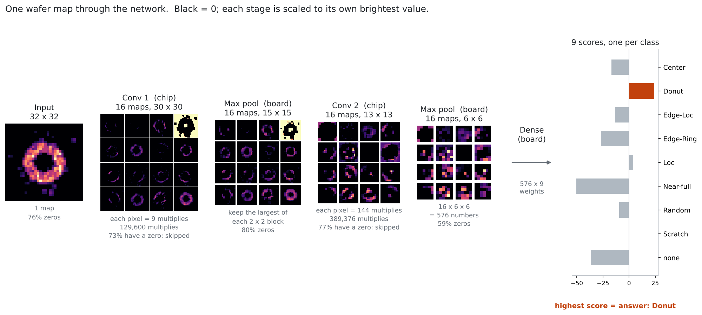
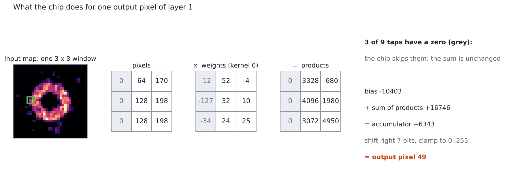

# Sparsity-Aware CNN Accelerator for Wafer-Map Defect Classification

**Full project, code and tests: [github.com/izaiah-thigpen/tt-sparse-conv](https://github.com/izaiah-thigpen/tt-sparse-conv)**

A low-power convolution accelerator for classifying semiconductor wafer-map defects, taken from model
training to a chip in fabrication. Submitted to the Tiny Tapeout shuttle (SkyWater 130 nm) by Prof. David
Parent at SJSU; silicon expected June 2027.

Wafer maps are mostly blank, so 77% of the multiplies in the defect-classification CNN have a zero
operand. The chip detects those taps and holds the multiplier's inputs still instead of letting them
switch (operand isolation).

**Highlights**
- **ASIC:** SystemVerilog multiply-accumulate unit with zero-skip operand isolation, a skip counter, an SPI
  interface and an on-chip activity mode for power measurement. RTL-to-GDS with LibreLane/OpenROAD:
  2,690 cells in 2 tiles, 50 MHz at every corner, zero DRC/LVS errors.
- **Power:** gate-level power flow with open-source tools (Yosys, Icarus, OpenSTA). Zero-skipping cuts the
  MAC's dynamic power **23% at 50% zeros and 66% at 90%**; flip-flop clock power limits the whole-chip
  saving to 7.7%, which points to clock gating next.
- **FPGA:** 9-MAC parallel engine on a Zynq-7020 (PYNQ-Z1) at 100 MHz with AXI DMA; **all 180 test wafer
  maps matched the reference model bit for bit**.
- **Model:** 7,673-parameter CNN trained in PyTorch on WM-811K (811k real wafer maps), 9 defect classes,
  macro F1 0.82 in 8-bit integers.
- **Verification:** cocotb testbenches on the RTL and the post-layout gate-level netlist, run in GitHub
  Actions on every push.
- **Test hardware:** MicroPython test kit for the returned chips, and a 4-layer KiCad host board with a TI
  INA228 power monitor to measure the saving on silicon.

**Where to look in the full repository**
- `src/` — the chip RTL (`mac_core.sv`, `conv_chip.sv`)
- `docs/wafer_to_class.md` — from a wafer to a defect class, with figures
- `power/` — the gate-level power flow and results
- `fpga/` — the PYNQ-Z1 engine and notebook
- `pcb/` — the host board
